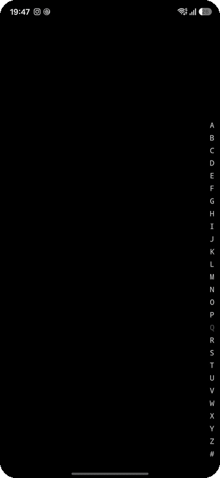

# risco

A home screen for Android that you use with one thumb. Your apps are listed by name under the
letters along the edge of the screen: slide to a letter, slide to the app, let go.

<p align="center">
  
</p>

## TL;DR

- **What it is:** a replacement for your phone's home screen. Instead of pages of icons, there's a
  column of letters on the edge. Every app is one thumb stroke away, and the letters never move,
  so your thumb learns where things are.
- **Who it's for:** anyone who knows which app they want and doesn't want to hunt for it. It's
  built for one-handed use, works with either thumb, and works with TalkBack.
- **What it costs you:** nothing. It's free, has no ads, can't go online, and does nothing in the
  background.
- **How to get it:** download the APK from the latest release, open it, and type `:default` in
  search when you want it as your home screen. Full steps are [below](#install).

| Quick facts | |
|---|---|
| Download size | 145 KB |
| Memory | About 30–40 MB while it's your home screen |
| Battery | Nothing runs in the background, so it only uses battery while you're looking at it |
| Internet | None. risco has no permission to go online, so nothing about you leaves the phone |
| Permissions | Two: opening the notification shade, and asking Android to uninstall an app you chose |
| Price | Free, no ads, open source ([GPL-3.0](LICENSE)) |
| Phones | Android 11 or newer |
| Languages | English, German, Portuguese, Spanish, French, Russian, Japanese |

## Install

1. On your phone, open the [latest release](https://github.com/kayfgit/risco/releases/latest) and
   download `risco-<version>.apk`.
2. Open the download. Android asks once to allow installs from your browser; allow it.
3. Open risco to try it. It doesn't replace your home screen until you type `:default` in search
   and pick it.

To update, install the newer release the same way: your pins and settings stay. To go back to
your old home screen, type `:default` and pick it, or uninstall risco.

## Using risco

| To | Do this |
|---|---|
| Open an app | Press the letters on either edge, slide to a letter, slide off towards the list, slide to the app, let go |
| Change your mind | Let go on the letters or past the far end of the list, or slide back onto the letters for another one |
| Search | Swipe up, type, press Enter. It ignores accents and matches word starts and initials (`gm` finds Google Maps) |
| See notifications | Swipe down |
| Use an app's shortcuts (New message, New tab…) | Hold the app on home or in search |
| Add an app to home, hide it, or uninstall it | Hold the app on home or in search |
| Add a website or chat to home | Use that app's own "Add to home screen", then confirm. Hold it to remove it |
| Rename an app or shortcut | Hold it, then Rename. Search still finds it by its old name |
| Change wallpaper, add widgets, turn icons on | Hold empty space on home |
| Move, resize or remove a widget | Hold it, then drag it, drag a corner, or tap Remove. Tap elsewhere when done |

There are letters on both edges, one for each thumb, but only the one you used last is shown.
Press the other edge and it takes over. A letter with no apps hands over to the nearest one that
has some.

The letters come from your phone's languages, plus A to Z: a Russian phone gets А to Я as well,
a Japanese one the kana rows. For a shorter column, `:alphabet` picks one alphabet only, and
names in other scripts are spelled in it ("Камера" goes under K on `:alphabet english`).

risco follows your phone's language unless `:language` gives it its own. Commands are always
typed in English.

App shortcuts, and websites or chats added to home, need risco to be your home screen
(`:default`): Android only shares them with the home screen.

### Commands

Type these in search. Anything that takes an app suggests matches as you type, and Enter picks
the one at the bottom.

| Command | What it does |
|---|---|
| `:pin <app>` / `:unpin <app>` | Add to or remove from home. `:unpin` also takes shortcuts |
| `:rename <app>` | Give an app or shortcut your own name |
| `:hide <app>` / `:unhide <app>` | Take an app off the letters and out of search, or bring it back |
| `:info <app>` | Android's page for the app |
| `:rm <app>` | Uninstall |
| `:widget <widget>` | Add a widget to the top of home |
| `:wallpaper` | The phone's wallpaper picker |
| `:icons <on\|off>` | Grey icons beside app names. Off by default |
| `:alphabet <name>` | Which letters to show: `default`, `english`, `russian`, `japanese`, `greek`, `korean`, `arabic`, `hebrew`, `hindi` or `thai` |
| `:language` | Android's page for risco's own language (Android 13 and up) |
| `:menu` | What holding empty space opens |
| `:set` | Android settings |
| `:default` | Choose your home screen |
| `:q` | Close search |

### With TalkBack or Switch Access

Each letter is a button: touch or swipe to it to hear "G, 10 apps", and double-tap for a menu of
its apps. Search, notifications, and wallpaper and widgets are in the actions menu of every letter
and pinned app, since swipes and holds on home go to TalkBack. A widget's actions menu moves,
resizes and removes it a step at a time.

---

## For developers

Everything below is for building, changing or reviewing risco.

### Build

You need JDK 17 and the Android SDK (platform 34, build-tools 34). Android Studio isn't needed.

```powershell
.\gradlew.bat test              # the drag, search and commands, no phone needed
.\gradlew.bat spotlessApply     # format (ktlint)
.\gradlew.bat lint              # Android Lint; any warning fails
.\install-local.ps1             # build, install on the connected phone, open
```

A copy you build yourself is signed with a different key from the releases, so it can't update a
release install or the other way round. Uninstall one before installing the other. Installing
doesn't replace the phone's launcher; that only happens with `:default`.

### What's where

```
app/src/main/java/com/kayf/risco/   the app (Kotlin, no libraries beyond Kotlin's own)
app/src/main/res/                   layouts, strings, and the six translations (values-xx)
app/src/test/java/com/kayf/risco/   unit tests, run on the PC (Robolectric for Android parts)
docs/design.md                      where risco might go next, with the reasoning
docs/model.py, docs/usage.py        the timing model and launch statistics behind design.md
docs/demo/                          the README's GIF and the scripts that record it
.github/workflows/                  ci.yml for every push and PR, release.yml for tags
install-local.ps1                   build, install and open on a connected phone
```

| File | |
|---|---|
| [Drag.kt](app/src/main/java/com/kayf/risco/Drag.kt) | The whole gesture, with no Android in it, so it's tested on the PC |
| [RailView.kt](app/src/main/java/com/kayf/risco/RailView.kt) | Feeds touches to `Drag` and draws what it says |
| [Alphabet.kt](app/src/main/java/com/kayf/risco/Alphabet.kt) | Which letters the rail shows, and which letter a name goes under |
| [Fuzzy.kt](app/src/main/java/com/kayf/risco/Fuzzy.kt) | Search ranking and accent folding |
| [Commands.kt](app/src/main/java/com/kayf/risco/Commands.kt) | The `:` line |
| [Apps.kt](app/src/main/java/com/kayf/risco/Apps.kt) | Installed apps, kept up to date by the system |
| [Store.kt](app/src/main/java/com/kayf/risco/Store.kt) | Pins, hidden apps, names and settings, saved on the phone |
| [Shortcuts.kt](app/src/main/java/com/kayf/risco/Shortcuts.kt) | App shortcuts and pinned websites or chats |
| [Widgets.kt](app/src/main/java/com/kayf/risco/Widgets.kt) | Widgets on home, and how `:widget` names them |
| [WidgetEditor.kt](app/src/main/java/com/kayf/risco/WidgetEditor.kt) | Moving and resizing a widget |
| [Hold.kt](app/src/main/java/com/kayf/risco/Hold.kt) | A press held still, for home's menu and a widget's |
| [HomeRoot.kt](app/src/main/java/com/kayf/risco/HomeRoot.kt) | Swipes and holds on home |
| [Access.kt](app/src/main/java/com/kayf/risco/Access.kt) | TalkBack and Switch Access actions |
| [PinActivity.kt](app/src/main/java/com/kayf/risco/PinActivity.kt) | Confirms a website or chat another app wants on home |
| [MainActivity.kt](app/src/main/java/com/kayf/risco/MainActivity.kt) | Home, search and wiring |

### Contributing

Issues and pull requests are welcome.

1. Make a branch for one change; nothing goes to `main` directly.
2. Write a test with every feature. For a bug, write the failing test first, then fix it.
3. Before pushing, run `spotlessApply`, `lint` and `test` (above). CI runs the same checks plus a
   release build on every pull request, and keeps the APK for two weeks under the run's artifacts.
4. Add a line under Unreleased in `CHANGELOG.md` saying what changed, in plain words.

Two rules shape risco:

- **Everything can be changed by the user.** Every behaviour or look needs a way to change it, as
  a command or a gesture, not a preset menu.
- **Plain words on screen.** Menus and messages use plain, capitalised words ("Uninstall", not
  `rm`). Commands stay short because they're typed.

### Releasing

1. Raise `versionCode` and `versionName` in `app/build.gradle.kts`.
2. In `CHANGELOG.md`, move what's under Unreleased into a `## <version> - <date>` section that
   starts with a short TL;DR. That section becomes the release notes.
3. Merge to `main`, then tag and push: `git tag v<version>` and `git push origin v<version>`.

The release workflow checks the tag matches the version, runs lint and the tests, builds the APK
signed with the release key from the repository's secrets, checks the signature, and publishes the
release with the APK attached. The key and its password are also in `.env` (never committed) with
the key file outside the repository; both need backing up, since a lost key means no more updates.

### How the quick facts were measured

On a Galaxy A36 (Android 17) with 108 apps installed, risco 0.2.0:

- **Download size:** `risco-0.2.0.apk` is 144,770 bytes. Release builds are shrunk with R8 and
  use no libraries beyond Kotlin's own.
- **Memory:** `adb shell dumpsys meminfo com.kayf.risco` with risco as the home screen settles at
  27–42 MB (total PSS). For a few seconds right after it starts it can be much higher (about
  290 MB was seen once); why hasn't been looked into yet.
- **Background and internet:** the manifest has two activities and no services, receivers or
  scheduled jobs, and asks only for `EXPAND_STATUS_BAR` and `REQUEST_DELETE_PACKAGES`, with no
  `INTERNET`.
